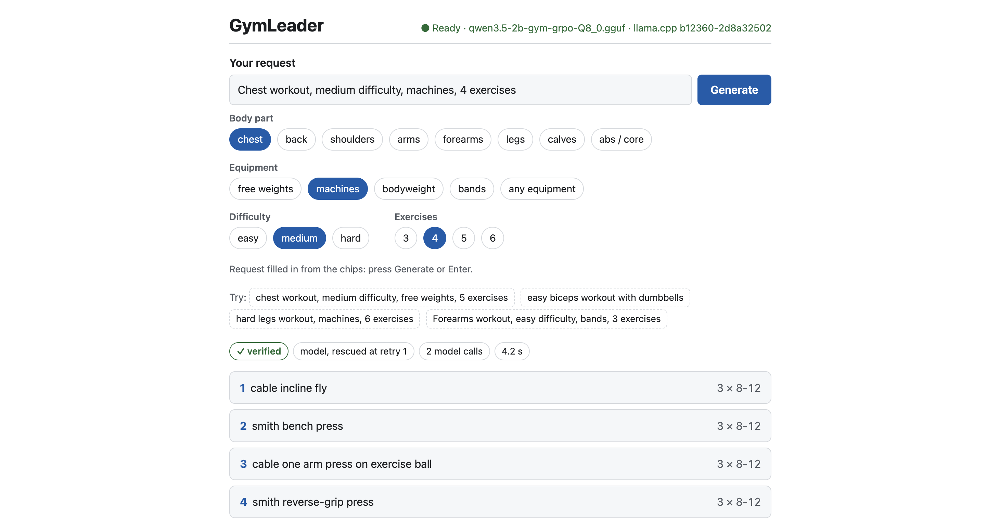
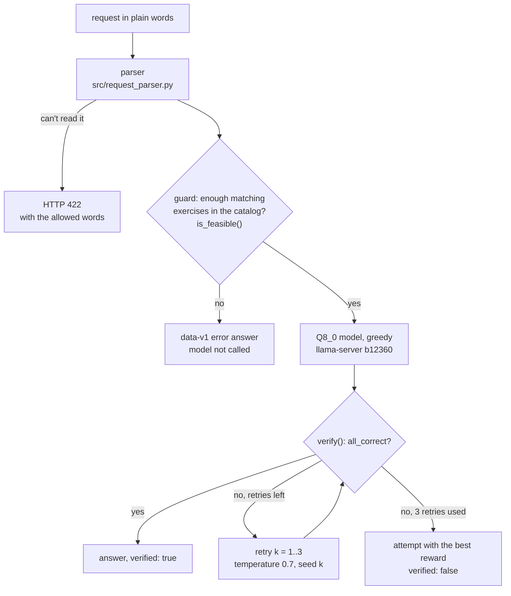

# GymLeader: a 2B model that writes your gym workout, and a verifier that checks every line of it

[](https://huggingface.co/riccardoroselli/qwen3.5-2b-gym-grpo-GGUF)
[](https://github.com/users/riccardoroselli/packages/container/package/gymleader)
[](https://github.com/unslothai/unsloth)
[](LICENSE)

Ask for *"chest workout, medium difficulty, free weights, 5 exercises"* and GymLeader writes the workout as JSON. Every exercise is an exact name from a real [exercise catalog](https://github.com/hasaneyldrm/exercises-dataset), with the sets and reps that difficulty calls for. If the catalog doesn't have enough matching exercises, it tells you so instead of making some up.

The model is Qwen3.5-2B, trained with SFT (LoRA) and then GRPO. On 300 held-out requests, all_correct goes from 0.00 for the base model to 0.24 after SFT and 0.55 after GRPO. Put a guard and verifier retries around it and the served system reaches **0.82** (measured on Metal; the Docker CPU image scored 26/30 on a 30-row check).

It all fits in one Docker container on a CPU: llama.cpp b12360 with the Q8_0 GGUF (2.1 GB), a FastAPI service and a web page.

**The core idea: one verifier, used four ways.** [`src/verifier.py`](src/verifier.py) `verify(request, answer)` checks an answer against the task contract in [`docs/spec.md`](docs/spec.md). The same function is used in four places:

| job | where | what `verify()` does there |
|---|---|---|
| data check | [`src/make_dataset.py`](src/make_dataset.py) | every generated train / val / test answer must pass before the files are written |
| eval metric | `src/evaluate.py score` | gives all_correct and reward for each test answer, for every model and every engine |
| GRPO reward | [`notebooks/03_grpo_colab.ipynb`](notebooks/03_grpo_colab.ipynb) | `verify()["reward"]` is the reward, so training optimizes the number that is reported |
| quality control when serving | [`src/api.py`](src/api.py) | an answer that is not all_correct is sampled again, up to `MAX_RETRIES=3` times |

Checks: parse, strict format, names in the catalog, body part, equipment, count, no duplicates, sets/reps, no advanced exercise in easy or medium workouts, and the error answer for impossible requests. all_correct means every check passed.
The reward is in [0, 1]: **reward = 0.1 × strict format + 0.9 × content**, where content is the weighted average of the checks (names 0.30, body part 0.15, equipment 0.15, count / duplicates / sets-reps / advanced 0.10 each). For an impossible request, content is 1 for an error answer and 0 for a workout. An answer that doesn't parse gets 0.



*The web page at http://127.0.0.1:8000. The greedy answer to this request failed the verifier. Retry 1 passed, so the page shows "verified" after 2 model calls (4.2 s).*

## Quick start

**Docker, on any machine (CPU, linux/amd64 or linux/arm64):**

```bash
docker run -d --name gymleader -p 127.0.0.1:8000:8000 -v gymleader-models:/models ghcr.io/riccardoroselli/gymleader:v1.0
docker logs -f gymleader        # wait for "ready at http://127.0.0.1:8000", then Ctrl-C (the container keeps running)
```

Open **http://127.0.0.1:8000**, or call the API directly (`/docs` lists its endpoints):

```bash
curl -s 127.0.0.1:8000/workout -H 'Content-Type: application/json' \
     -d '{"request": "chest workout, medium difficulty, free weights, 5 exercises"}'
```

- **The first start downloads the 2.1 GB model once** (about 3 min at ~11 MB/s); **later starts take seconds** (2.5 s from model load to ready).
  - The Q8_0 file comes from [the GGUF repo](https://huggingface.co/riccardoroselli/qwen3.5-2b-gym-grpo-GGUF) at a pinned revision, into the `gymleader-models` volume, and its sha256 is checked before the server starts.
  - No Hugging Face token is needed.
  - The page answers only after the download.
- **Normal log lines:**
  - 15 `unused tensor blk.24…` warnings, from the multi-token-prediction layer, which is kept in the file but not used;
  - `PyTorch was not found`, because only the tokenizer is used.
- **Stop:** `docker stop gymleader`. The volume keeps the model.

**Docker Compose, from a clone:**

```bash
git clone https://github.com/riccardoroselli/SFT-Gym-Workout-Program.git && cd SFT-Gym-Workout-Program
docker compose up -d            # pulls the image; builds docker/Dockerfile if it can't
docker compose logs -f          # same log as above
docker compose down             # the gymleader-models volume and the model stay
```

**On a Mac without Docker (Metal),** with [`scripts/run_local.sh`](scripts/run_local.sh). It needs:
- `llama-server` from llama.cpp **b12360** on PATH: the build every evaluation used, and the script warns on any other. Download `llama-b12360-bin-macos-arm64.tar.gz` from the [b12360 release](https://github.com/ggml-org/llama.cpp/releases/tag/b12360) (tested on macOS arm64), unpack it, and add the folder that contains `llama-server` to PATH. For other systems, see llama.cpp's [build docs](https://github.com/ggml-org/llama.cpp/blob/master/docs/build.md).
- a Python 3.12 env with `requirements-serve.txt` installed.

```bash
pip install -r requirements-serve.txt
scripts/run_local.sh            # model into models/gguf/, all layers on the GPU, http://127.0.0.1:8000; Ctrl-C stops both
```

**The model alone, in LM Studio or llama.cpp.**
- **LM Studio:** search for `riccardoroselli/qwen3.5-2b-gym-grpo-GGUF`, download the Q8_0 file, and set **Temperature 0** (LM Studio ignores the file's default).
- **llama-server:**

  ```bash
  hf download riccardoroselli/qwen3.5-2b-gym-grpo-GGUF qwen3.5-2b-gym-grpo-Q8_0.gguf \
      --revision bbb1d3cf7f9113ec518b56c95a74702bbd83ba9b --local-dir .
  llama-server -m qwen3.5-2b-gym-grpo-Q8_0.gguf -ngl all -c 4096 -np 1 --host 127.0.0.1 --port 8080
  curl -s http://127.0.0.1:8080/v1/chat/completions -H "Content-Type: application/json" -d '{
    "messages": [{"role": "user", "content": "chest workout, medium difficulty, free weights, 4 exercises"}],
    "temperature": 0, "max_tokens": 512}'
  ```
- **What the file does by itself:** its chat template adds the training system message and turns thinking off, and its default temperature is 0.
- **Tested:** through this chat API, the file gave the evaluated answer on 300 / 300 test requests.
- **More:** MLX code, compatibility and sha256 are on the [GGUF card](https://huggingface.co/riccardoroselli/qwen3.5-2b-gym-grpo-GGUF) and the [gym-grpo card](https://huggingface.co/riccardoroselli/qwen3.5-2b-gym-grpo).

## Results

These are model results: 300 test requests, 16 of them impossible, with greedy decoding and thinking off, scored by `verify()`.

| model | names in catalog | no duplicates | impossible refused | all_correct | reward |
|---|---|---|---|---|---|
| Qwen3.5-2B, zero-shot | – | – | 0/16 | 0.00 | 0.000 |
| Qwen3.5-2B, 3 examples in the prompt | 0.161 | 0.943¹ | 0/16 | 0.00 | 0.415 |
| SFT (MLX bf16) | 0.750 | 0.405 | 4/16 | 0.24 | 0.785 |
| SFT + GRPO (MLX bf16) | 0.948 | 0.663 | 6/16 | 0.55 | 0.915 |
| **SFT + GRPO, GGUF Q8_0** (llama.cpp) | 0.955 | 0.660 | 6/16 | 0.55 | 0.918 |

¹ High only because few of its names are real catalog names. Zero-shot answers never had the right JSON shape, so their workout columns are empty.

**System result, not a model result:** the served system scores **0.82 all_correct and 0.985 reward, with 16 / 16 impossible requests answered with an error**. The system is the parser, the guard, the Q8_0 model, and up to 3 verifier retries.
- `MAX_RETRIES=3` was fixed before testing, not tuned on the test set.
- It was measured with llama.cpp b12360 on Metal (Apple M4).
- The model alone is the 0.55 above.

How the gains add up:
- The guard adds +10 requests (0.55 → 0.58).
- Each retry adds about 0.08 (0.67, 0.74, 0.82).
- GRPO more than doubled all_correct over SFT, so its reward gain is not just partial credit.
- MLX bf16, GGUF BF16 and GGUF Q8_0 are the same within noise.

Full tables: [`eval/results/results.md`](eval/results/results.md). Notes per stage: [baseline](eval/baseline_notes.md), [SFT](eval/sft_notes.md), [GRPO](eval/grpo_notes.md), [GGUF](eval/gguf_notes.md), [system](eval/system_notes.md).

## Findings

- **Refusals moved as one dial.** On the 40-row val check during GRPO, the model refused 3 of 13 impossible requests at step 0, 12 at step 250 and 3 again at step 300, and its false refusals of feasible requests rose and fell with them (0, 3, 0 of 27). It learned "refuse more" or "refuse less", not which requests are impossible. Feasibility can be computed exactly from the catalog, so the guard answers those requests instead: 16 / 16 on test. [GRPO notes](eval/grpo_notes.md)
- **RL sharpened what SFT taught; it didn't teach new names.** After GRPO, 92% of the names the model lists appear in train answers (SFT: 74%), and it uses fewer distinct names (223 vs 263). It stopped paraphrasing names it knew, and the names it never learned are still missing. [GRPO notes](eval/grpo_notes.md)
- **Q8_0 costs nothing, Q4_K_M costs most of GRPO's gain.** In the paired bootstrap, MLX → GGUF BF16 and BF16 → Q8_0 both have intervals that contain 0. Q4_K_M drops all_correct from 0.54 to 0.25 (−0.293 [−0.350, −0.240]), about back to the SFT level, so it isn't published. [GGUF notes](eval/gguf_notes.md)
- **Retries take the system from 0.58 to 0.82, but they can't add knowledge.** 54 of 284 model requests still fail after 3 retries. In 11 of the 22 that fail on names, every one of the 4 attempts has a name that isn't in the catalog, and the same wrong names come back (`bodyweight standing archer`, 6 times). In 3 hard abs workouts with free weights, every attempt picks band exercises. [system notes](eval/system_notes.md)
- **Decision rules were fixed before looking at the results.** The GRPO sampling temperature (0.7) came from a rule written before the probe ran. `MAX_RETRIES=3` was set in the design, not tuned on the test set. The Docker image's GCC 14 build had a pass rule before its 30-row check (no errors, only near-tie flips, r3 within ±3 of 25 / 30), which it passed with 26 / 30. [GRPO notes](eval/grpo_notes.md), [system notes](eval/system_notes.md)

## How a request is handled



- **Parser:** it reads body part, equipment group, difficulty and count from the [spec vocabulary](docs/spec.md#request-vocabulary), plus serving-only aliases (`biceps → arms`, `dumbbells → free weights`). The response lists each alias it used in `interpreted_as`.
- **Guard:** it answers impossible requests without calling the model, since feasibility can be computed exactly from the catalog.
- **Every response says how the answer was made:**
  - `source`: `guard`, `model_greedy` or `model_retry_k`;
  - `verified`;
  - `checks`;
  - `model_calls`;
  - every attempt, with its text, seed, reward and time.
- **Latency on Metal:**
  - a request that passes at greedy takes 2.7 s (mean of the 159 such requests);
  - the mean per model request is 3.1 s at r0 (greedy only) and 6.7 s at r3 (with up to 3 retries);
  - a request makes 2.06 model calls on average;
  - the 54 of 284 model requests that never pass take 13–15 s.

## How evaluation works

- **Data** ([`data-v1`](https://github.com/riccardoroselli/SFT-Gym-Workout-Program/tree/data-v1/data/processed), frozen tag): `src/make_dataset.py` (seed 42) generates 2,000 train, 200 val and 300 test rows from the catalog.
- **Held out:** test uses only request combinations (body part × equipment × difficulty × count) held out from training, 15% of them. It also uses only 3 phrasing templates that train and val never use (train and val have 10). The generator asserts both.
- **Impossible requests:** 16 of the 300 test requests can't be answered with a workout. The right answer is the error.
- **Decoding:** greedy, thinking off, at most 512 new tokens. MLX runs the safetensors models; `llama-server` runs the GGUF files, with the identical prompt sent raw to `/completion`.
- **Scoring:** `verify()` on every answer. all_correct is the headline metric, and the reward is reported next to it so partial credit can't hide a lack of real progress.
- **Paired bootstrap** ([`src/compare_runs.py`](src/compare_runs.py)): two runs answered the same 300 requests, so each request is compared with itself. The script resamples the requests 10,000 times (seed 42) for 95% intervals.
  - MLX → GGUF BF16 and BF16 → Q8_0: both intervals contain 0.
  - BF16 → Q4_K_M: all_correct −0.293 [−0.350, −0.240]. That is why Q4_K_M is not published.
- **The system** ([`src/eval_service.py`](src/eval_service.py)): every test request is sent to the live API. One run with `MAX_RETRIES=3` is enough to derive the answers for 0–3 retries.

```bash
python src/evaluate.py generate --run sft_grpo --model riccardoroselli/qwen3.5-2b-gym-grpo   # MLX → eval/outputs/
python src/evaluate.py score --run sft_grpo                                                  # → eval/results/
python src/compare_runs.py sft_grpo sft_grpo_gguf_bf16                                       # paired comparison
```

Raw answers (`eval/outputs/`) are not in git: `generate` recreates them. MLX needs Apple silicon and `requirements.txt`.

## Training

Both notebooks run on Google Colab with a T4 GPU or better. On a free Colab T4, SFT took 19 min and GRPO 48.6 min. Each one checks that `data/processed/` equals the `data-v1` tag before training.
They need a Colab secret `HF_TOKEN` with write access, because they upload the results to the Hub under that token's user.

**SFT** [](https://colab.research.google.com/github/riccardoroselli/SFT-Gym-Workout-Program/blob/main/notebooks/02_sft_colab.ipynb)
- **Method:** bf16 LoRA (r=16, alpha=16, all attention and MLP projections) with Unsloth + TRL `SFTTrainer`, with the loss on the answer only.
- **Run:** 2,000 train rows, 2 epochs = 250 steps, learning rate 2e-4, 16 rows per step.
- **Outcome:** final val loss 0.2607. It taught the format, the count and the sets/reps; names and duplicates remained the failures.

**GRPO** [](https://colab.research.google.com/github/riccardoroselli/SFT-Gym-Workout-Program/blob/main/notebooks/03_grpo_colab.ipynb)
- **Method:** continues the SFT LoRA with TRL `GRPOTrainer` + Unsloth. The reward is `verify()["reward"]`.
- **Run:**
  - 600 train prompts, 20% of them impossible;
  - 8 answers per prompt at temperature 0.7, 2 prompts per step;
  - 300 steps, KL penalty 0, learning rate 5e-6.
- **Outcome:** names in the catalog 0.75 → 0.95, duplicates 59% → 34% of workouts, refusals 4 → 6 of 16.

The GGUF files were made with llama.cpp's converter, then [`gguf/`](gguf/). That code adds the chat template and the greedy default, and splits the fused tensors so older loaders such as LM Studio's can read the files. The tensor bytes are unchanged. Details: [`eval/gguf_notes.md`](eval/gguf_notes.md).

## System requirements

| | Docker image | `scripts/run_local.sh` |
|---|---|---|
| hardware | linux/amd64 or linux/arm64, **CPU only** (no GPU inside the container) | Mac with Apple silicon (Metal) |
| memory | 4.44 GiB in `docker stats` during a request (Docker Desktop, M4) | not measured |
| disk | image 623 MB + model 2.08 GB | model 2.08 GB in `models/gguf/` |
| speed (Apple M4) | CPU, 10 cores: 34 tok/s fresh, 15–20 tok/s when hot. Mean per model request 4.0 s at r0 (greedy only), 8.5 s at r3 (29 model rows of 30 test rows) | Metal: 43.2 tok/s writing (`llama-bench` tg128). Mean per model request 3.1 s at r0 (greedy only), 6.7 s at r3 (284 model rows of 300 test rows) |
| network | first start only: the 2.1 GB model download | the same, plus the 4 tokenizer files |

The CPU speeds come from the two-container setup of `docker-compose.dev.yml` (the same llama.cpp tag, CPU build, and the same model and API), on a fanless MacBook Air, which slows down as it heats up. Other CPUs will differ.

## Repository layout

```
src/                      the system, as Python modules
  verifier.py             verify() and is_feasible(): the task contract as code
  spec.py                 contract values shared by every script (body parts, equipment groups, sets/reps)
  request_parser.py       free text → structured request, deterministic, with serving aliases
  api.py                  FastAPI: parser → guard → model → verifier retries; GET / serves the page
  serve.py                container entrypoint: model download + sha256 → llama-server → API
  llama_client.py         client for llama-server, shared by evaluate.py and api.py
  web/                    the page: plain HTML/CSS/JS, no framework, no CDN
  build_catalog.py        data/raw → data/processed/catalog.json
  make_dataset.py         catalog → data-v1 train / val / test, self-checked with verify()
  evaluate.py             generate (MLX or llama-server) and score
  compare_runs.py         paired bootstrap between two runs
  eval_service.py         evaluates the whole system through its HTTP API
  analyze_errors.py       first failed check, near-miss vs invented names, duplicates
  probe_groups.py         pre-GRPO probe: does sampling the SFT model give a learning signal?
  label_advanced.py       review of the "advanced" exercise flags

data/                     → data/README.md (source, commit, license)
  processed/              catalog.json, advanced_ids.json, train/val/test.jsonl (tag data-v1)
docs/spec.md              the task contract: request vocabulary, answer format, impossible requests
notebooks/                01 data exploration, 02 SFT on Colab, 03 GRPO on Colab (executed, with outputs)
eval/                     notes per stage (baseline, sft, grpo, gguf, system)
  results/                scores per run (.json) and the summary table results.md
gguf/                     chat template, split of fused tensors, and the checks behind them
cards/                    the Hugging Face model cards of the 5 repos
docker/                   Dockerfile (all-in-one image), api.Dockerfile (two-container dev setup)
docker-compose.yml        the all-in-one image; docker-compose.dev.yml: llama.cpp's image + the API
scripts/run_local.sh      the system on a Mac without Docker (Metal)
tests/                    pytest: fakes stand in for the model and llama-server
licenses/                 NOTICE.md (what the image bundles) and the dataset's MIT license
.github/workflows/        tests.yml (pytest), image.yml (multi-arch image to GHCR + smoke test)
```

The tests need no model, GPU or llama-server, and CI runs them on every branch push and pull request:

```bash
pip install -r requirements-test.txt
python -m pytest -q
```

## Known limitations

- **Impossible requests depend on the guard.**
  - The model alone refuses only 6 of 16; the guard catches all 16.
  - The training data's impossible requests come from only 5 body part × equipment pairs, so the model may have learned those pairs rather than to count matching exercises.
- **Duplicates:** about a third of greedy workouts repeat an exercise or list two variants of it (`x`, `x v. 2`). Retries raise no_duplicates from 0.66 to 0.90.
- **Names:**
  - about 5% of names the model writes are not exact catalog names, and some wrong names come back again and again (`bodyweight standing archer`);
  - retries can't add knowledge: 54 of 284 model requests still fail after 3 retries, and come back marked `"verified": false`.
- **The 0.82 is a Metal number.** In the CPU image, greedy answers differ from Metal's where two tokens are nearly tied. On a 30-row check, 1 row is answered by the guard; on the other 29, the greedy text matched Metal's 19 times, and 26 of the 30 were all correct with retries, and seeded retries reproduce only on the same build, backend and hardware.
- **Retries cost time:** the slowest requests took up to about 20 s on Metal and 24.3 s on the CPU.
- **Scope of the evaluation:** one test set of 300 requests, greedy decoding only. English requests, this one task only.
- GymLeader suggests workouts; it is not medical advice.

## Links

| what | where |
|---|---|
| final model (merged, bf16 safetensors) | [riccardoroselli/qwen3.5-2b-gym-grpo](https://huggingface.co/riccardoroselli/qwen3.5-2b-gym-grpo) |
| GGUF files (Q8_0, BF16) | [riccardoroselli/qwen3.5-2b-gym-grpo-GGUF](https://huggingface.co/riccardoroselli/qwen3.5-2b-gym-grpo-GGUF) |
| final LoRA adapter (on Qwen3.5-2B) | [riccardoroselli/qwen3.5-2b-gym-grpo-lora](https://huggingface.co/riccardoroselli/qwen3.5-2b-gym-grpo-lora) |
| SFT stage, merged / adapter | [riccardoroselli/qwen3.5-2b-gym-sft](https://huggingface.co/riccardoroselli/qwen3.5-2b-gym-sft) · [riccardoroselli/qwen3.5-2b-gym-sft-lora](https://huggingface.co/riccardoroselli/qwen3.5-2b-gym-sft-lora) |
| Docker image | `ghcr.io/riccardoroselli/gymleader` |
| base model | [Qwen/Qwen3.5-2B](https://huggingface.co/Qwen/Qwen3.5-2B) |
| exercise data | [hasaneyldrm/exercises-dataset](https://github.com/hasaneyldrm/exercises-dataset), MIT |

## License

The code, the web page and data-v1 are released under [Apache-2.0](LICENSE). The model is fine-tuned from Qwen/Qwen3.5-2B (Apache-2.0).

The exercise catalog is derived from [hasaneyldrm/exercises-dataset](https://github.com/hasaneyldrm/exercises-dataset) at commit `7455efa`: MIT, © 2026 Hasan Emir Yıldırım ([`licenses/exercises-dataset-MIT.txt`](licenses/exercises-dataset-MIT.txt)). Only the data is used, none of its media, which are © Gym visual.

What the Docker image bundles, and under which license: [`licenses/NOTICE.md`](licenses/NOTICE.md).
